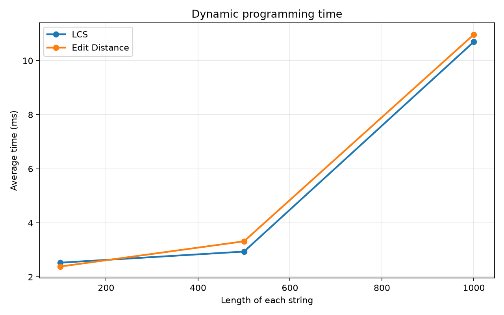
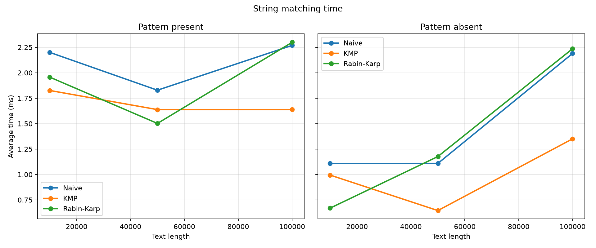
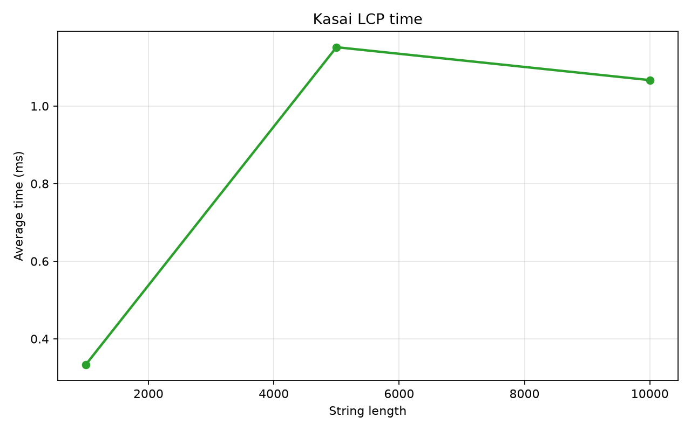

# Assignment 4 - Text Analysis

This is a Java project for comparing text algorithms. It has LCS, Edit Distance, Naive matching, KMP, Rabin-Karp, and Kasai's LCP algorithm. `Main` shows small examples, `Tests` checks the results, and `Benchmark` measures running time.

## Run

I used JDK 25 in IntelliJ. Run the `Main`, `Tests`, and `Benchmark` classes there, or use PowerShell in the project folder:

```powershell
$sources = Get-ChildItem src -Recurse -Filter *.java | ForEach-Object FullName
New-Item -ItemType Directory -Force build | Out-Null
javac -d build $sources
java -cp build Main
java -cp build Tests
java -cp build Benchmark
```

`Benchmark` saves `results/tables/benchmark.csv`. Python is only needed to redraw the plots:

```powershell
python -m pip install matplotlib
python scripts/plot_results.py
```

## How the algorithms work

LCS and Edit Distance use 2D DP tables. For LCS, the empty row and column are zero. If the last characters match, `dp[i][j] = dp[i-1][j-1] + 1`. Otherwise, it is the larger of `dp[i-1][j]` and `dp[i][j-1]`. The last character is either shared, or one of the two last characters can be skipped.

For Edit Distance, the first row and column count insertions and deletions. Equal last characters keep the diagonal value. Otherwise, `dp[i][j] = 1 + min(delete, insert, substitute)`. These are the three possible last edits.

Naive matching checks every starting position. KMP makes an LPS table and uses it after a mismatch, so it does not restart the text comparison. Rabin-Karp compares rolling hashes. When hashes match, it also checks the actual characters, because different strings can have the same hash.

All matching methods return zero-based indices, including overlapping matches. An empty pattern matches at every boundary, from `0` to `text.length()`. A longer pattern has no matches. Indices use Java `char` positions. The experiment uses the alphabet `ACGT`.

Kasai takes a string and its suffix array. `lcp[i]` is the shared prefix length of the suffixes at positions `i-1` and `i` in that array; `lcp[0] = 0`. It reuses the previous prefix length. I used a simple suffix-array helper, but its construction time is not part of the Kasai measurement. For `banana`, the suffix array is `[5, 3, 1, 0, 4, 2]` and LCP is `[0, 1, 3, 0, 0, 2]`.

## Complexity

Here `a` and `b` are the DP string lengths, `n` is text length, `m` is pattern length, and `k` is the number of matches. Space includes the returned matches. Matching bounds assume a nonempty pattern with `m <= n`.

| Algorithm | Main operation | Preprocessing | Best time | Worst time | Space | Reason |
|---|---|---|---|---|---|---|
| LCS | Match: diagonal + 1; else max of top and left | None | `O(ab)` | `O(ab)` | `O(ab)` | Fills every DP cell. |
| Edit Distance | Match: diagonal; else 1 + min of three edits | None | `O(ab)` | `O(ab)` | `O(ab)` | Fills every DP cell. |
| Naive | Try the pattern at each position | `O(1)` | `O(n-m+1)` | `O((n-m+1)m)` | `O(k)` | A position may fail at once or need `m` checks. |
| KMP | Use LPS after a mismatch | `O(m)` | `O(n+m+k)` | `O(n+m+k)` | `O(m+k)` | Text and pattern indices do not move back through all earlier work. |
| Rabin-Karp | Roll the hash, verify equal hashes | `O(m)` | Expected `O(n+m+km)` | `O(nm)` | `O(k)` | Many hash hits can need full pattern checks. |
| Kasai | Reuse the previous LCP length | Suffix array given | `O(n)` | `O(n)` | `O(n)` | The prefix counter goes up and down at most `O(n)` times. |

Rabin-Karp's expected time assumes few hash collisions. Its worst case can be much slower. These are theoretical bounds, not the timings below.

## Tests

`Tests` prints `PASS: 62 checks`. It covers identical, different, and empty LCS strings; Edit Distance insertion, deletion, and substitution; matching at the start, middle, and end, multiple and overlapping matches, absent and long patterns, and an empty pattern. Every matching case checks that all three methods return the same indices. Kasai is checked with the manually verified `banana` example and a few edge cases.

## Experiment

I ran this on Windows with an Intel i5-13420H and Temurin OpenJDK 25.0.4.1. The random seed is `20261107 + input size`. Strings use `ACGT`. LCS and Edit Distance use the same pair of strings at each size. Naive, KMP, and Rabin-Karp use the same text and pattern for each comparison. The present pattern is taken from the middle of the text; the absent pattern is 24 `T` characters, checked to be absent. The suffix array is built before Kasai is timed.

| Workload | Sizes |
|---|---|
| LCS and Edit Distance | Two strings of length 100, 500, 1000 |
| Matching | Text length 10000, 50000, 100000; present and absent patterns |
| Kasai | String length 1000, 5000, 10000 |

Each case has 3 warm-up runs and 5 timed runs. `System.nanoTime()` measures only the algorithm call; the table uses the average. Input generation, printing, and file writing are outside the timed part. The CSV also stores DP cell counts and matching comparisons. Rabin-Karp's comparison count only includes character checks after a hash hit, so operation counts from different methods should not be compared directly.

## Results

Times below are milliseconds from one run. Exact nanoseconds and operation counts are in `results/tables/benchmark.csv`.

| String length | LCS ms | LCS result | Edit ms | Edit result | DP cells each |
|---:|---:|---:|---:|---:|---:|
| 100 | 2.528 | 62 | 2.385 | 58 | 10000 |
| 500 | 2.939 | 320 | 3.318 | 269 | 250000 |
| 1000 | 10.697 | 654 | 10.967 | 519 | 1000000 |



| Text length | Pattern | Naive ms | KMP ms | Rabin-Karp ms | Matches |
|---:|---|---:|---:|---:|---:|
| 10000 | Present | 2.201 | 1.826 | 1.957 | 1 |
| 10000 | Absent | 1.108 | 0.994 | 0.669 | 0 |
| 50000 | Present | 1.829 | 1.638 | 1.502 | 1 |
| 50000 | Absent | 1.109 | 0.645 | 1.176 | 0 |
| 100000 | Present | 2.270 | 1.638 | 2.300 | 1 |
| 100000 | Absent | 2.190 | 1.351 | 2.236 | 0 |



| String length | Kasai ms | LCP entries |
|---:|---:|---:|
| 1000 | 0.333 | 1000 |
| 5000 | 1.152 | 5000 |
| 10000 | 1.067 | 10000 |



## Discussion and conclusion

The DP tables grow from 10000 to 1000000 cells, and their times rise. KMP has a better worst-case bound than Naive matching. On these random strings, Naive often stops after an early mismatch, so the measured difference is small. Rabin-Karp had one real hash hit in each present case and none in the absent cases, but it still hashes every window. Kasai's 10000-character run was slightly faster than its 5000-character run; short timings can vary. This one experiment does not show that one matching method is always fastest. The main trade-off is simpler code versus stronger worst-case guarantees, while the DP methods also need quadratic table space.
